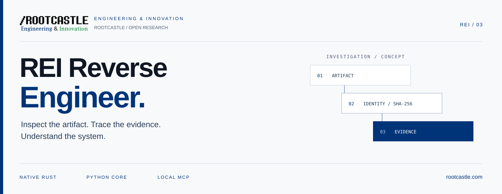
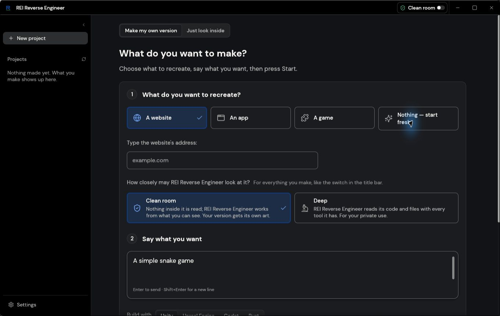
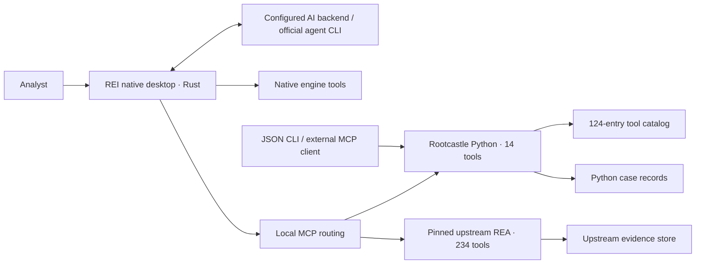

<p align="center">
  <a href="https://rootcastle.com"></a>
</p>

<h1 align="center">REI Reverse Engineer</h1>

<p align="center"><strong>Inspect the artifact. Trace the evidence. Understand the system.</strong></p>
<p align="center">A native research workbench connecting software analysis, AI assistance and reproducible evidence.<br>Built by <a href="https://rootcastle.com">Rootcastle Engineering &amp; Innovation</a>.</p>

<p align="center">
  <a href="https://github.com/rootcastleco/Rei-Reverse-engineer/actions/workflows/ci.yml"></a>
  <a href="https://github.com/rootcastleco/Rei-Reverse-engineer/actions/workflows/desktop.yml"></a>
  <a href="docs/DESKTOP-SPEC.md"></a>
  <a href="LICENSE"></a>
</p>

<p align="center">
  <a href="#start-the-desktop">Desktop setup</a> · <a href="#connect-your-ai">AI connections</a> · <a href="#use-the-python-workbench">CLI &amp; MCP</a> · <a href="#what-is-verified">Verification</a> · <a href="#responsible-use-and-legal-disclaimer">Legal notice</a>
</p>

---

## From an unknown artifact to a defensible finding

Reverse engineering starts with questions: What is this file? What changed? Which tool can answer the next question? What evidence supports the conclusion?

REI Reverse Engineer brings those steps into one native workspace. The Rust application connects the Rootcastle Python workbench and the separately versioned REA server through local MCP. AI providers help navigate the work; artifact identity, coverage limits and source references keep the investigation grounded.

| Identify | Investigate | Preserve | Connect |
| :--- | :--- | :--- | :--- |
| Static signatures, full-file SHA-256 and bounded metadata. | PE, ELF and WASM structures, version differences and format-aware plans. | Local case records, confidence labels and integrity-checked exports. | Native Rust tools, Python MCP, upstream REA and configurable AI backends. |

**124 catalog entries · 14 Python MCP tools · 234 upstream MCP tools · 12 specialist skills**

These numbers describe different things. Catalog entries are metadata; discovered routes are callable interfaces. Neither establishes that every tool is installed, authorized or verified on your machine.

## Inside the native application



*Actual, unaltered Windows application capture. The image shows the project request screen, not a completed AI build or an analysis result.*

The desktop provides a shared interface for projects, AI connections and tool results. The launcher registers the Python and upstream MCP servers with the native engine. Their results reach the same desktop evidence interface, while each server retains its own storage.

The application is a licensed source fork of [Craft Anything](https://github.com/storytold/craft-anything), adapted with Rootcastle identity, isolated settings and the REI integration. The [original REA project](https://github.com/morluto/rea) remains pinned separately. See [source provenance](#open-source-provenance).

> [!IMPORTANT]
> **Development preview.** The Windows application has been built and opened locally. Real static-analysis calls have passed through both MCP bridges. This is an unsigned source-build preview; all 248 external routes, third-party analyzers and AI-assisted workflows have not been individually validated.

## Start the desktop

**Windows x64 prerequisites:** Git, Python 3.10+, Rust 1.97.0, Visual Studio C++ build tools and the Windows SDK. Python 3.11+ is recommended for merging newly available upstream settings into an existing profile.

```powershell
git clone https://github.com/rootcastleco/Rei-Reverse-engineer.git
cd Rei-Reverse-engineer
python -m pip install -e .
git submodule update --init

./scripts/setup_upstream.ps1
./scripts/build_desktop.ps1
./scripts/run_desktop.ps1 -Python (Get-Command python).Source
```

Setup downloads a pinned project-local Node runtime, locked upstream dependencies and the version-matched REA native addon. The build script compiles the desktop from source. The launcher prepares local MCP settings and refreshes tool discovery before opening the application.

After the first build, double-click **`REI Reverse Engineer.cmd`** to start the combined workbench. Use the launcher to supply the Python runtime and MCP profile. Existing user settings are retained; `REI_CONFIG_DIR` selects an alternative profile.

[Desktop guide](desktop/README.md) · [Rootcastle fork notes](desktop/ROOTCASTLE.md) · [Integration evidence](docs/DESKTOP-VERIFICATION.md)

## Connect your AI

Open **Settings → AI** and choose the connection that matches your account and environment.

| Connection | How it works | What you need |
| :--- | :--- | :--- |
| **Experiential Labs** | OpenAI-compatible gateway, streaming responses and live model listing. | Your provider API key in the masked field or `EXPLABS_API_KEY`. |
| **ChatGPT account / Codex** | The installed official Codex CLI opens its browser sign-in flow. | Codex CLI and an eligible ChatGPT account. |
| **Google account / Antigravity** | The installed official Antigravity CLI handles provider sign-in. | Antigravity CLI and the required account access. |
| **Codex Cloud** | Opens the official cloud workspace in your browser. | A supported account; local REI operations use the CLI connection. |
| **Other backends** | Configure supported agent, hosted or compatible server connections. | The selected backend's runtime, credentials and terms. |

Account sign-in is handled by the official CLI. REI does not scrape browser cookies, read provider credential caches or retain login output. Missing CLI installations show setup links. Antigravity's dedicated login command is version-dependent; terminal onboarding and Detect/Add are the documented fallback.

**No API key does not mean free or unlimited access.** Provider plans, quotas and charges still apply. Codex Cloud is a separate web workspace; opening it does not turn its browser session into a local chat API.

When you select a hosted model or cloud agent, submitted prompts, tool results and context may leave your machine. Review sensitive material and the provider's policies before sharing. See [AI setup, official references and verification limits](docs/AI-CONNECTIONS.md).

## What you can do today

| Surface | Available capability | Boundary |
| :--- | :--- | :--- |
| **Native desktop** | Projects, AI configuration and native/MCP tool dispatch. | Windows source-build preview; unsigned. |
| **Python analysis** | Identification; bounded PE/ELF/WASM parsing; signals and structural comparison. | Partial format coverage; no decompilation or target execution. |
| **Evidence cases** | SHA-256 identity, hash-linked notes, SQLite metadata search and portable bundles. | Integrity checks do not establish semantic truth or a signed chain of custody. |
| **Tool catalog** | 124 searchable records with capabilities and PATH discovery. | A record does not install or integrate its tool. |
| **External adapters** | Eleven fixed static CLI adapters and twelve provider profiles. | Explicit opt-in; only reviewed operations execute. Many profiles are discovery-only. |
| **Python MCP** | Fourteen structured local operations. | Case creation writes metadata; other tools are read-only. No arbitrary shell runner. |
| **Upstream REA bridge** | 234 discovered tools at the pinned revision. | Static entropy dispatch verified; other operations retain upstream requirements and consent boundaries. |
| **Agent skills** | Twelve specialist investigation guides. | Guidance is distinct from an installed analysis engine. |

Keep four states separate: **cataloged → PATH-detected → adapter-supported → end-to-end-verified**. A later state requires its own evidence.

Read the [provider contracts](docs/PROVIDERS.md), [core specification](docs/SPEC.md) and [desktop specification](docs/DESKTOP-SPEC.md) for exact scope.

## Use the Python workbench

The dependency-free Python core also works independently of the desktop on Windows, Linux and macOS with Python 3.10+.

```bash
python -m pip install -e .
rei-rea --version
rei-rea tools doctor
rei-rea tools list --tag android

# Read-only inspection of an artifact you are authorized to analyze.
rei-rea inspect /path/to/sample.bin
rei-rea deep /path/to/sample.exe
rei-rea investigate /path/to/sample.wasm

# Compare exact artifacts and their parsed structures.
rei-rea compare /path/to/old.bin /path/to/new.bin
rei-rea diff /path/to/old.wasm /path/to/new.wasm
```

Commands return structured JSON. Built-in inspection does not execute or unpack the target. `signals --include-strings` is optional because extracted strings can expose confidential data. The combined investigation pipeline accepts files up to 64 MiB.

### Keep a reproducible case

```bash
rei-rea case init /path/to/sample.bin --workspace .rei-cases

# Replace CASE-ID with the directory returned above.
rei-rea case note .rei-cases/CASE-ID --type analyst-note \
  --text 'Header at offset 0x20 requires verification' \
  --source 'artifact:0x20' --confidence inferred

rei-rea case verify .rei-cases/CASE-ID --recheck-target
rei-rea case report .rei-cases/CASE-ID --output finding.md
rei-rea case index .rei-cases
rei-rea case search .rei-cases --kind pe
rei-rea case bundle .rei-cases/CASE-ID case-evidence.zip
rei-rea case bundle-verify case-evidence.zip
```

Findings distinguish `observed`, `inferred` and `unknown`. Case bundles contain metadata, notes and integrity manifests, **never the original binary**. Review notes and paths before sharing. A valid hash chain detects changes to a record; it does not prove that its conclusions are correct.

### Connect an MCP client

Start the server with `rei-rea mcp`, or configure a client that accepts `mcpServers`:

```json
{
  "mcpServers": {
    "rei-rea": {
      "command": "rei-rea",
      "args": ["mcp"]
    }
  }
}
```

Use an absolute executable path if your client cannot resolve `rei-rea`. Client permissions and OS access controls still apply. The Python server exposes fourteen tools; the desktop upstream bridge is configured separately by the launcher.

<details>
<summary><strong>View the Python MCP tool reference</strong></summary>

| Tool | Purpose |
| :--- | :--- |
| `rei_rea_providers` | Discover provider profiles. |
| `rei_rea_tools` | Filter catalog entries. |
| `rei_rea_doctor` | Inspect PATH availability. |
| `rei_rea_inspect` | Identify and hash an artifact. |
| `rei_rea_plan` | Plan an investigation. |
| `rei_rea_signals` | Read bounded file signals. |
| `rei_rea_compare` | Compare local files. |
| `rei_rea_case_create` | Create a local evidence case. |
| `rei_rea_case_verify` | Verify a case record. |
| `rei_rea_investigate` | Run the static pipeline with hash cross-checks. |
| `rei_rea_deep` | Parse bounded PE/ELF/WASM structures. |
| `rei_rea_diff` | Compare parsed structures. |
| `rei_rea_case_search` | Search an existing casebook index. |
| `rei_rea_bundle_verify` | Verify an exported evidence bundle. |

</details>

The catalog dashboard runs with `rei-rea serve --port 8765` at **http://127.0.0.1:8765**. It is a loopback catalog viewer, with no target uploads or executable launch interface.

## How the parts work together



Dispatch and evidence presentation are shared in the desktop. Storage remains owned by each engine. External tools and artifact-reading operations retain the desktop's consent and mode controls.

## Specialist investigation skills

Twelve packages cover orchestration, bounded binary analysis, native binaries, Electron/JavaScript, Android, firmware/IoT, authorized mobile runtime work, evidence ledgers, casebook forensics, reconstruction parity, web/protocols, and WASM/managed code.

Browse [the skill packages](skills/) and [installation guide](docs/SKILLS.md). Installing a skill supplies instructions, not a binary analyzer, MCP registration or permission to test a third-party system.

## What is verified

Local evidence was recorded on **Windows 11 x64 · Rust 1.97.0 · Python 3.14.7 · Node 24.22.1**:

- Native executable built; its real window was opened and inspected.
- MCP discovery registered **248 external routes**. Python artifact identification and upstream byte-entropy analysis both returned through the desktop engine for the same synthetic WASM fixture and SHA-256.
- The AI/UI/CLI Rust suite passed **352 tests**. The Python suite ran **65 tests: 64 passed, one optional-tool skip**.
- All **12 root skills** validated. Formatting, Clippy with warnings denied, layer checks, lock checks and the source secret scan passed.
- Experiential streaming and model listing passed loopback integration tests. **Live paid API calls and user OAuth sign-in were not performed.**

These checks apply to the recorded environments and operations. They do not verify all upstream tools, decompiler accuracy, device behavior, AI-generated rebuild quality or production readiness. The pinned upstream npm installation reported **11 moderate advisories**; release hardening remains open. Remote results are available in [GitHub Actions](https://github.com/rootcastleco/Rei-Reverse-engineer/actions).

[Desktop verification evidence](docs/DESKTOP-VERIFICATION.md) · [AI verification boundaries](docs/AI-CONNECTIONS.md) · [Core stabilization](docs/STABILIZATION.md)

## Develop and contribute

```bash
python -m pip install -e .
PYTHONPATH=src python -m unittest discover -s tests -v
python scripts/generate_catalog.py
```

On PowerShell, set `$env:PYTHONPATH = 'src'` before the unittest command. Python CI covers Python 3.10 and 3.13 on Linux, Windows and macOS. The desktop workflow builds and tests Windows separately.

Start with [AGENTS.md](AGENTS.md), [the architecture](docs/ARCHITECTURE.md), [the threat model](docs/THREAT_MODEL.md) and existing tests. Add capabilities through reviewed adapters with contracts and regression coverage. Keep customer binaries, secrets and proprietary samples out of this public repository.

Next priorities include provider-specific verification, parser fuzzing, dependency remediation and signed desktop releases. See [the roadmap](docs/ROADMAP.md), [learning path](docs/LEARNING_PATH.md) and [upstream synchronization policy](docs/UPSTREAM-SYNC.md).

## Responsible use and legal disclaimer

> [!WARNING]
> **Authorized use only. Use at your own risk.** Analyze only software, devices, recordings and systems you own or have explicit permission to inspect. You are responsible for your actions, legal compliance, permissions, data handling and third-party service charges.

**To the maximum extent permitted by applicable law, Rootcastle Engineering & Innovation, the authors, maintainers and contributors provide this software “AS IS” and “AS AVAILABLE,” without warranties, and disclaim liability for claims, losses or damages arising from its use, misuse or inability to use it.** This includes unauthorized activity, inaccurate analysis or AI output, data loss, security incidents, service interruption, device damage and third-party costs.

No tool output or reconstruction guarantees correctness, safety, ownership or legal permission. Reconstructed or decompiled output must not be represented as original source. Dynamic analysis, live probing and firmware modification require separate scoped authorization and isolation. This project does not grant permission to bypass licenses, access controls or other parties' rights.

**These exclusions apply only where legally enforceable. Nothing excludes liability or rights that applicable law does not allow to be excluded.** Read the complete [Responsible Use & Legal Disclaimer](DISCLAIMER.md), [MIT License](LICENSE) and [security reporting policy](SECURITY.md).

## Open-source provenance

| Component | Origin and license | Maintenance |
| :--- | :--- | :--- |
| **Rootcastle Python workbench and integration** | [MIT](LICENSE), © 2026 Batuhan AYRIBAS. | Original implementation in `src/rei_rea/` and integration scripts. |
| **Native desktop foundation** | [Craft Anything](https://github.com/storytold/craft-anything), MIT OR Apache-2.0. | Licensed fork in `desktop/`; exact revision in [ROOTCASTLE-FORK.json](desktop/ROOTCASTLE-FORK.json). |
| **Upstream REA** | [morluto/rea](https://github.com/morluto/rea), under its retained license. | Separately pinned submodule; connected through local MCP. |
| **Fonts, icons and dependencies** | Their respective licenses. | Retained [NOTICE](desktop/NOTICE), [ATTRIBUTION](desktop/ATTRIBUTION.md) and license documentation. |

Keep required notices with redistributions. Code licenses do not grant third-party trademark rights. Rootcastle branding identifies this adaptation; no upstream or provider endorsement or affiliation is implied.

The header uses the official [Rootcastle logo](https://rootcastle.com/brand/rootcastle-rei.svg) in an original SVG composition. See [artwork provenance](docs/images/README.md). Discovery metadata is maintained in [repository-metadata.json](.github/repository-metadata.json).

---

<p align="center"><strong>ROOTCASTLE · ENGINEERING &amp; INNOVATION</strong><br><a href="https://rootcastle.com">rootcastle.com</a> · <a href="https://github.com/rootcastleco">Open-source engineering</a><br><sub>Measure first. Reconstruct second. Verify always.</sub></p>
